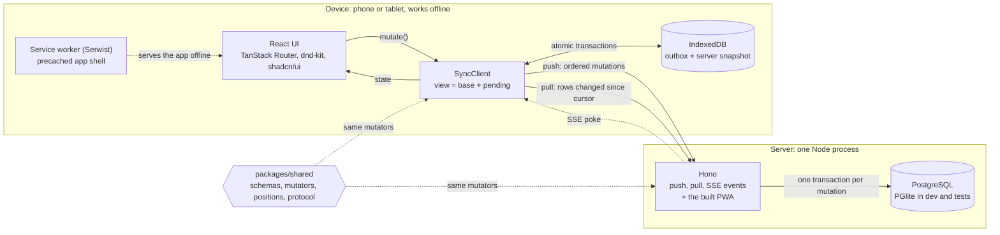
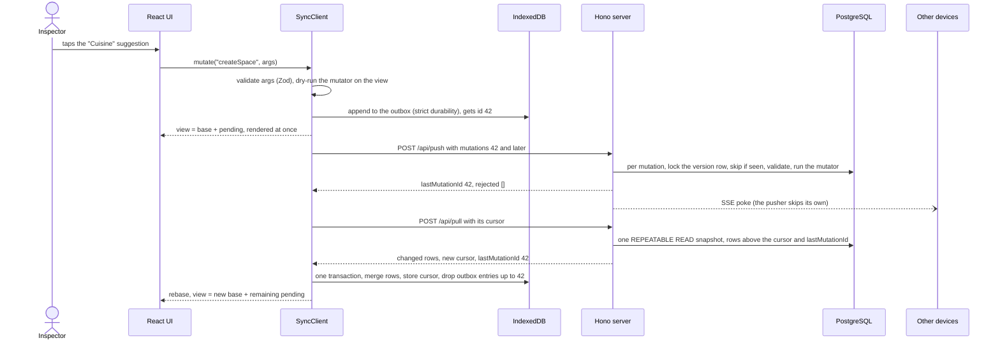

# Relevé: design

Relevé (French for an on-site survey) is the levels-and-rooms module of a housing inspection app.
A diagnostician creates a *logement*, describes its levels (Sous-sol, RDC, R+1…) and their rooms,
renames, deletes and reorders them by drag and drop: on a phone, with or without network. It was
built for Auditoo's take-home exercise as if it were going to production.

Three constraints drove every decision:

| Constraint | What it changed |
| --- | --- |
| **Offline for hours.** Basements, thick walls, rural dead zones: no network is the normal case. | The device is the source of truth for the UI. Screens render the local copy and never wait for the network; the server is reached in the background. |
| **Never lose data.** A typed room must survive crashes, reloads, lost responses, retries, other devices, even a replaced server database. | A change is written to a durable outbox before the UI shows it, pushes are idempotent, and a mutation leaves the outbox only once a pull proves the server has it. No queued change can block a device, and none disappears without a word. |
| **Fast with one thumb.** Standing in a corridor, phone in one hand. | Main actions in a bottom bar, one gesture per intent, gestures sized to what they delete, one-tap suggestions, undo instead of confirmation dialogs. |

## Architecture



Three pnpm workspaces, served from one origin (no CORS, one deploy, one service worker scope):

| Workspace | Role | Start reading at |
| --- | --- | --- |
| `packages/shared` | Domain code run verbatim on both sides: Zod schemas, mutators, fractional positions, wire protocol, in-memory snapshot | `src/mutators.ts`, `src/protocol.ts` |
| `apps/web` | React 19 PWA: sync engine (`src/sync/`), screens (`src/features/`), service worker (`src/sw.ts`) | `src/sync/sync-client.ts` |
| `apps/server` | Hono on Node 22: sync API, PostgreSQL access, security headers, static hosting of the built PWA | `src/sync/push.ts`, `src/sync/pull.ts` |

### Life of a mutation



## Data model and database

Logement → levels → rooms. Code and schema say *property* and *space*; the UI says *logement*,
*niveau* and *pièce*.

| Table | Synced fields (shared shape) | Notes |
| --- | --- | --- |
| `properties` | `id`, `name`, `createdAt`, `deletedAt` | Listed newest first |
| `levels` | `id`, `propertyId`, `name`, `position`, `deletedAt` | Ordered by `position` within a property |
| `spaces` | `id`, `levelId`, `name`, `position`, `deletedAt` | Ordered by `position` within a level |
| `server_meta` | Singleton: `version` (global, the pull cursor), `epoch` (database identity, migration 002) | Server only |
| `clients` | Per device: `last_mutation_id` | Server only, makes pushes idempotent |
| `rejected_mutations` | Per device and mutation id: why it was rejected (migration 003) | Server only, lets a retried push report its rejections again |

Synced tables also carry `version` (the global version that last wrote the row) and `updated_at`.
SQL: `apps/server/src/db/migrations.ts`; shapes: `packages/shared/src/schemas.ts`.

| Decision | Why |
| --- | --- |
| **PostgreSQL; PGlite in development and tests** | Everything the sync relies on is built in: transactions, row locks, savepoints, `REPEATABLE READ` snapshots, `COLLATE "C"`, constraints; managed hosting is a click. PGlite is Postgres compiled to WebAssembly, embedded in the Node process: `pnpm dev` and `pnpm test` need no Docker yet run the same SQL, behind one small interface (`SqlClient`, `apps/server/src/db/sql.ts`). |
| **Migrations: embedded SQL, append-only, applied at boot** | Each runs in its own transaction under `pg_advisory_xact_lock`, so instances booting together during a deploy do not race. |
| **Properties above levels** | An inspector handles several dwellings a day. It also gives the router a real job: `/` lists logements, `/logements/$propertyId` shows one. |
| **UUIDv7 ids generated on the device** | Entities are created offline and referenced at once (a room in a level created a second ago, both still queued). Time-ordered ids keep index inserts local and give a stable "newest first" tie-break. |
| **Soft deletes** (`deletedAt`) | A delete is a row change like any other, so it syncs through the same cursor, and undo is just a `restore*` mutation. Deleting a level hides its rooms without touching them; restoring it brings them all back. |
| **Epoch-ms `bigint` timestamps, taken from the mutation** | Mutators are deterministic, so server rows are identical to what the device computed optimistically and the next pull changes nothing on screen (asserted in `apps/server/src/sync/sync.test.ts`). The price: `createdAt` and `deletedAt` come from device clocks, which only drive display order. |
| **`position text COLLATE "C"`** | Fractional keys compare by code unit (see [Ordering](#ordering-with-fractional-indexes)). |
| **Names: 1 to 80 characters, no control characters, no half emoji** | Validated on input by `nameSchema` (French messages); the length is also a SQL `CHECK`. A lone UTF-16 surrogate has no UTF-8 form: the database would store U+FFFD, and the server's row would differ from the device's. Rows read back use a looser schema: if input rules tighten later, a row stored under the old rules must never make a pull fail and block a device. |
| **Foreign keys** `levels → properties`, `spaces → levels` | The database guards the tree, even against a buggy mutator. |

## Sync strategy

The model is Replicache's (push, pull, rebase), written as plain, readable TypeScript.

```text
POST /api/push  { clientId, epoch?, mutations: [{ id, name, args, timestamp }] }  →  { lastMutationId, epoch, rejected: [{ id, reason }] }
POST /api/pull  { clientId, cursor }  →  { epoch, cursor, lastMutationId, reset, changes: { properties, levels, spaces } }
GET  /api/events    server-sent events: "poke" { version, clientTag } after each push that changed data
```

A poke names the pusher by `clientTag`, the first 16 bytes of its client id's SHA-256: that device
skips it, as it pulls right after pushing anyway, and its other tabs hear of the push over the
BroadcastChannel ([why not the id itself](#tradeoffs-considered-and-rejected)).

### Isomorphic mutators

`packages/shared/src/mutators.ts` defines what each of the 15 user actions does, once: create,
rename, delete and restore for each entity, plus `moveLevel`, `moveSpace` (which can change level)
and `duplicateLevel`. A mutator is an async function over a tiny transaction interface
(`MutatorTx`: get and put per entity), implemented by `SnapshotTx` (copy-on-write maps) on the
device and by `ServerTx` (SQL upserts stamped with the new version) on the server.

Mutators are deterministic: they read only the transaction, their arguments and the mutation
timestamp; ids and positions are computed by the caller and travel as arguments. The optimistic
view can only differ from the server when another device changed the same data, and the next pull
reconciles it. Mutations are intents ("move this room there"), not row states: the server re-runs
them on its current rows, so a rename and a concurrent move of the same room both survive. As a
put replaces the whole row, **a create refuses an id that exists**, deleted or not: a reused room
id would move that room, even to another logement. Only a faulty client reuses one: ids are drawn
on the device and a create is judged once, which the convergence simulation checks.

**A level copy is one mutation that carries its rooms**: `duplicateLevel { id, sourceId, name,
position, spaces: [{ id, name, position }] }`, at most 100 rooms. Not `createLevel` plus a
`createSpace` per room: N + 1 transactions, so other devices could pull the level before its rooms
and a refused room would leave a partial copy; one mutation is one transaction (a room the database
refuses rolls the whole copy back), one line in the sync sheet, one undo. Nor "copy level X" run
by the server: it would copy rooms the user never saw (another device's), with ids derived there.
The device names the copy and numbers its bedrooms; the mutator only reads the source (deleted
meanwhile, it stays deleted). A new mutation rather than `spaces` on `createLevel`: Zod strips
unknown keys, so a server predating the field (after a rollback) would create an empty level,
while it rejects an unknown mutation whole.

### On the device: base, outbox, view

`SyncClient` (`apps/web/src/sync/sync-client.ts`) holds `base`, the last snapshot confirmed by the
server (IndexedDB stores `properties`, `levels`, `spaces`, and `meta` for client id, cursor and
epoch); `pending`, the outbox of mutations the server has not confirmed; and
`view = applyMutations(base, pending)`, what React renders through `useSyncExternalStore`.

`mutate()` validates and normalizes the arguments (names trimmed, as the server will see them),
refuses a mutation too large for a push of its own, dry-runs the mutator on the view (an action on
stale state is refused before anything is stored), appends to the outbox, then publishes the new
view. A mutation is **durable before it is visible**, and leaves the outbox only when a pull shows
the server processed it, never on a push acknowledgement alone. State transitions are serialized:
none can lose or double-apply a mutation.

### Push: ordered, idempotent, never blocked

The device sends its outbox oldest first, in pushes of at most 100 mutations and 1 MiB of JSON
(`takePushBatch`), an eighth of the 8 MiB the server accepts: a push refused for its size would be
retried as it is, forever. Today's largest mutation, a 100-room copy with the costliest names,
takes 44 KB (`apps/server/src/app.test.ts` sends the largest push). `apps/server/src/sync/push.ts`
gives **each mutation its own transaction**:

1. `SELECT version, epoch FROM server_meta … FOR UPDATE`: take the version lock, check the epoch.
2. Skip the mutation if `id ≤ clients.last_mutation_id`: retries are no-ops; ids may have gaps.
3. Validate it with `mutationSchema` (the request itself only checks envelopes).
4. Run the mutator inside `SAVEPOINT mutation`, stamping written rows with `version + 1`; bump the
   version only if something was written.
5. Record `last_mutation_id`, and the rejection if there is one, then commit.

A mutation that can never apply is **rejected but acknowledged**: invalid (sent by another app
version, under rules that changed since), refused by its mutator (`MutationRejectedError`, e.g. an
unknown entity) or by the database (SQLSTATE class 22 or 23). The savepoint discards its partial
writes while the acknowledgement commits, so one bad mutation never blocks a device's queue. Any
other error is transient: earlier mutations stay committed, the request fails, the device retries.
The response lists rejected mutations by id with a reason code (`invalid`, `not_applicable`,
`refused_by_database`), never user data. Recorded with the acknowledgement (`rejected_mutations`),
they are reported again to a push retried after a lost response or a failure half-way. Installed
apps ignore the field; a device reads an older server's response as rejecting nothing, and reasons
as any string, so that a code a newer server adds cannot block it.

### Gapless versions: a row lock, not a sequence

The pull cursor means "I have every row up to this version", so versions must become visible in
order. With a Postgres `SEQUENCE`, transaction A takes version 5, B takes 6 and commits first; a
device pulling in between moves its cursor to 6 and never receives A's rows. Locking the
`server_meta` row serializes writers, so versions follow commit order. The cost, one writer at a
time for a few milliseconds per mutation, is irrelevant at this scale, and pulls never wait for it.

### Pull and rebase

`apps/server/src/sync/pull.ts` reads everything in one `REPEATABLE READ, READ ONLY` transaction:
version, epoch, this device's `last_mutation_id` and every row with `version > cursor`, deleted ones
included. Under `READ COMMITTED`, a push committing between two statements could show in the rows
but not in `lastMutationId`, and the device would replay that mutation on top of its own effects.
The device then rebases: it merges the rows into `base`, drops pending mutations up to
`lastMutationId`, replays the rest, and commits rows, cursor, epoch and outbox pruning in **one
IndexedDB transaction** before publishing. If anything fails, memory and storage still agree.

### No change disappears without a word

A change can leave the view without being applied: the server rejects it, or a replay finds it no
longer applies to newer server data (its level lost with a replaced database, say). The device
reports it once, in `SyncState.rejections` (the latest 20, listed in the sync sheet) and to
`onRejected` listeners (an error toast), worded by `describeRejection`, whose exhaustive switches
make every new mutation bring its French: « La pièce « Cuisine » n'a pas pu être déplacée vers
« R+1 » : le niveau n'existe plus. ».

- **Announced as it disappears**: a rejection a push reports is worded at once, while the queue
  holds the mutation, and announced when the pull that confirms it takes the change off the screen.
  A replaced database voids such verdicts: the new one judges the mutations again.
- **Other tabs** only see the mutation leave the outbox: the reporting tab tells them.
- **At startup**, queued changes that no longer apply are listed, not announced: old news.
- **No lock-out after an update.** The outbox may hold what another version of the app queued: an
  unknown kind, arguments breaking rules that tightened since. It is validated as it loads
  (`readStoredMutation`), such entries are not replayed, and any failure of the replay means "does
  not apply here": listed, kept for the server to judge, never thrown (a throw at startup would
  show « Stockage indisponible » for good).

### Replaced databases: reset and epoch

- **Reset.** A cursor ahead of the server means the database went back in time: the pull returns
  the full dataset with `reset: true` and the device replaces its base, keeping its outbox.
- **Epoch.** Each database draws a random UUID when created (migration 002), which devices send
  with every push. Another epoch means another database (recreated, or restored from a backup):
  the server processes nothing from that device, which starts over with a full pull and pushes its
  whole outbox again. Otherwise a device holding mutations the old database had acknowledged would
  push later ones first, and the new one would skip the earlier ones forever.

### When sync runs

| Trigger | Behaviour |
| --- | --- |
| A local mutation | Sync now; while a retry is scheduled, wait for it: the mutation is safe in the outbox, and says nothing about the network |
| An SSE `poke`, every (re)connection of the stream (pokes sent meanwhile are lost), the page becoming visible | Sync now, even while backing off: the server just proved reachable, or the user is back. Not for the poke of the device's own push, unless backing off |
| `online` event, "Synchroniser maintenant" button | Sync now and reset the backoff |
| Every 30 s while the page is visible | Sync, unless a retry is already scheduled; reopen the event stream if it gave up |
| A failed cycle | Retry after 1 s, doubling up to 30 s, ±20 % jitter so devices cut off together do not retry in lockstep |

A cycle is push then pull, each request bounded by 15 s (weak mobile networks hang rather than
fail), or a minute for the first request after 10 minutes without an answer: a sleeping Render
instance takes that long to wake, and 15 s would report every cold start as a failure
(`transport.ts`). A request that fails or times out while the browser reports a network shows
« Serveur injoignable », with a countdown to the retry: « Hors ligne », which would send the
user looking for a network they have, is kept for `navigator.onLine === false`. Neither is an
error; HTTP and protocol errors are, and the pill says « Erreur » until a cycle succeeds.

### Several tabs and durability

- **Web Locks** allow one push/pull cycle at a time per device; over a **BroadcastChannel**, a tab
  that wrote tells the others to reload IndexedDB, the single source of truth, and passes on the
  rejections it reports, which the storage cannot show.
- **Mutation ids** come from the outbox's `autoIncrement` key generator: increasing across tabs,
  never reused. Push reads the outbox from storage, so no tab sends a mutation before an older one.
- **Strict durability** on outbox writes (Chrome defaults to relaxed, which can lose the last writes
  on power loss), and `navigator.storage.persist()` to ask the browser not to evict the data.
- **Lost connections** (`storage.ts`): IndexedDB closed under the app (iOS in the background) is
  reopened and the operation, which wrote nothing, runs again; if the data was erased, or a newer
  app version took over, the page asks to be reloaded.

### Conflict policy

| Situation | Outcome | Why |
| --- | --- | --- |
| Two devices rename the same room | The last rename to reach the server wins | Predictable, and enough for short names |
| Two devices reorder the same list | Both moves apply (the same item: the last move wins) | A move rewrites only the moved item's key |
| Two offline devices append to the same level | Distinct keys | A random 4-character base62 suffix on every key; equal keys still sort by id, identically everywhere |
| Edit vs delete: rename, move into or add to a deleted item | **Edit wins**: the item and its parents are revived | No input is ever silently discarded; the worst case is an item reappearing, which can be deleted again |
| Delete a level | Its rooms are hidden with it; undo restores them all | One row write, nothing to remember about which rooms went together |
| Duplicate a level another device deleted or changed meanwhile | The copy is what the user saw; the source stays as the other device left it | The rooms travel in the mutation; a copy reads its source, it does not edit it |
| Delete an already deleted item | No-op, no version bump | Idempotent |
| Move a room to another logement | Rejected | A room belongs to one dwelling; drag and drop never offers it |
| A create reusing an id that exists, deleted or not (a copy's rooms included) | Rejected, on device and server alike | It would overwrite the entity (see [Isomorphic mutators](#isomorphic-mutators)) |
| Mutation on an entity the server does not know | Rejected, acknowledged, reported to the user (toast, sync sheet), dropped at the next pull | Only after a database wipe, or from a buggy client |

## Ordering with fractional indexes

`packages/shared/src/positions.ts` wraps rocicorp's `fractional-indexing`:

- A drop becomes **one** `moveSpace` or `moveLevel` whose `position` is a key strictly between the
  new neighbours (`positionAtIndex`); appends use `positionAtEnd`. Nothing else is renumbered, and
  keys are validated at the boundary (`isValidPosition`) so a malformed one cannot poison a list.
- **Jitter.** The algorithm is deterministic: two offline devices appending to the same list would
  compute the same key. A random 4-character base62 suffix makes that about 1 in 14 million, and
  should two keys still be equal, ties break by id (`compareByPosition`), identically everywhere.
- **The `localeCompare` trap.** Keys mix cases: in code-unit order `"Zz" < "a0"`. `localeCompare`,
  like a locale-aware database collation, interleaves cases and silently scrambles the list.
  Devices compare with `<` (`comparePositions`); position columns use `COLLATE "C"` (asserted in
  `apps/server/src/db/migrate.test.ts`), so a server-side `ORDER BY` agrees with every device.

A fast-check property test inserts at random indexes (300 runs, up to 200 inserts each) and checks
that the list stays strictly ordered with valid keys; 500 appends keep keys at 8 characters or less.

## Offline and PWA

| Decision | Why and how |
| --- | --- |
| **Precache the whole app shell** | Serwist (`apps/web/src/sw.ts`) precaches HTML, every JS chunk, CSS, icons, manifest and the self-hosted fonts at install, about 300 kB compressed: the app starts, and deep links open, offline. Navigations fall back to the precached `index.html`, except `/api/*`; `navigationPreload` is off, as its request would be wasted. |
| **No runtime caching of the API** | Data lives in IndexedDB and belongs to the sync engine; the server marks `/api/*` `no-store`. One cache, one truth. |
| **Updates wait for a tap** | A new version waits until "Mettre à jour" is tapped in a toast, so code is never swapped under someone typing. The first install takes control at once (`clientsClaim`) and says so, once: « Relevé fonctionne maintenant sans réseau. » (`apps/web/src/pwa.ts`). |
| **An install offer** | « Installer l’application » in the home screen's menu once the browser fired `beforeinstallprompt` (kept from before the first render: it fires early, once); on iPhone and iPad, a sheet with Safari's steps and why: iOS keeps the data of installed apps (`apps/web/src/install.ts`). Nothing once installed. |
| **Data before first paint** | `apps/web/src/main.tsx` opens IndexedDB before rendering: no loading state. Without IndexedDB (some private modes), a screen says so instead of half-working. |
| **HTTP caching** | Hashed `/assets/*` immutable for a year; entry points (`/`, `index.html`, `sw.js`, manifest) revalidated; a missing asset a real 404 rather than HTML (`apps/server/src/app.ts`). |
| **A fast first load** | `index.html` preloads the home screen's code and its typeface, which the router would only request once the app runs; the build writes Brotli copies of its text files; the first render is a React transition, run in short slices rather than one long task; bottom sheets mount on their first opening (vaul measures the window as a drawer mounts). CI holds the bundle to a budget (`pnpm size`). |

## Security headers

`apps/server/src/security-headers.ts` sets these on every response:

| Header | Policy and why |
| --- | --- |
| **Content Security Policy** | Everything from the app's origin; scripts only from its files, never inline or through `eval` (Zod's compiler, which uses `new Function`, is off in browsers: `packages/shared/src/zod-config.ts`); no plugins, no `<base>`, no native form submission, never framed. Inline `<style>` elements are allowed: vaul, Sonner and Radix's scroll lock insert some at runtime, one with computed content, so no hash fits, and a static, precached `index.html` cannot carry per-response nonces. Style attributes in markup stay forbidden (`style-src-attr 'none'`): React sets styles through the CSSOM. |
| **Permissions-Policy** | Denies 21 powerful features the app does not use (camera, geolocation, payment, USB…): a feature it adopts one day must be allowed there first. |
| **The usual others** | `Referrer-Policy: no-referrer`, HSTS, `nosniff`, `X-Frame-Options: DENY`, same-origin COOP and CORP. |

## UX decisions

| Decision | Detail |
| --- | --- |
| **French UI** | The users are French diagnosticians: trade vocabulary (logement, niveau, pièce, RDC, R+1, Combles), French typography (non-breaking spaces in « quotes » and "3 pièces"), French plural rules. Code stays in English. |
| **Signature: the level datum marker ▽** | Borrowed from building section drawings: a half-filled inverted triangle whose apex rests on the floor line. Every level header is drawn as a floor line carrying it (`apps/web/src/components/datum-marker.tsx`). |
| **Thumb zone** | The screen's main action ("Nouveau logement", "Ajouter un niveau") sits in a fixed bottom bar; toasts appear just above it; sheets slide up from the bottom. A sheet never shares the screen with a stale toast: opening one clears the toasts (the update offer aside), and a toast raised while it is open shows at the top and takes its own taps (`apps/web/src/components/ui/sonner.tsx`). A « restauré » toast replaces its entity's « supprimé » one. |
| **One gesture per intent** | Tap a name to rename it in place, swipe a row left to delete it, drag only by the grip handle. They never compete: a swipe locks to the horizontal axis after 8 px and leaves vertical scroll native, and handles and fields never start one. A mouse drags 4 px into a handle; a finger must first rest on it for 250 ms, still (the row then lifts, with a vibration), because a thumb scrolling the page often starts on a handle: a flick from one scrolls (`touch-action: manipulation`). |
| **Gestures sized to what they delete** | A room goes with a swipe past 40 % of its width, or a flick past a quarter of it: shorter, it is a twitch, not an intent. A level or a logement takes its rooms with it, so its swipe only reveals a « Supprimer » button to tap, as in mail apps (`apps/web/src/components/swipe-to-delete.tsx`). |
| **Undo instead of "Are you sure?"** | Deletes are soft, so each one shows a 6 s toast with "Annuler", which queues a `restore*` mutation (offline too): a confirmation dialog would tax every delete to protect the rare mistake. Moves (a drop, « Déplacer vers… ») and level copies can be undone too. Once the toast is gone, « Logements supprimés » (home menu) and « Éléments supprimés » (a logement's menu) list what was deleted, last first; a level comes back with its rooms. |
| **Other ways than gestures** | A ⋮ menu on every level and room, and in a logement's header: rename, delete, « Dupliquer le niveau », and for a room « Déplacer vers… », a sheet of the other levels (the room goes to the end of the one picked). Touch and pen open a menu on the tap: Radix opens it on pointerdown, so a scroll starting on a ⋮, one per room, opened it (`components/ui/dropdown-menu.tsx`). |
| **Keyboard, focus, screen readers** | Drag and drop works with the keyboard (Space, arrows, Escape), announced in French with where the item would land (« position 2 sur 4 dans « R+1 » »), handles described as « poignée de déplacement ». The focus never falls to the page body, where keyboard and screen reader users lose their place: after a rename it goes back to the name, after a delete to the next row, and « Renommer » in a menu puts it in the field, which on a phone is what opens the keyboard. Sheets take the focus as they open (their text field when typing is the point) and give it back to what opened them. Accessible names start with the visible text (WCAG 2.5.3), the sync pill's included (« Hors ligne, 14 modifications en attente »). |
| **Identical floors in one tap** | « Dupliquer le niveau » copies a level with its rooms: a floor becomes the next free floor in the source's spelling (R+1 → R+2, 1er étage → 2e étage), anything else « RDC (copie) »; bedrooms take the logement's next numbers, other rooms keep their names. |
| **Show where things land** | A level copied, a room moved by menu or just added is tinted for a moment (a static tint with reduced motion), and scrolled into view when it may be out of sight. Suggestions hold still under the thumb as the rooms they add pile up above them (the page scrolls by as much, before it paints), and tapping one leaves the focus, hence the keyboard, in the room field; the field stays clear of the action bar and the keyboard as typed rooms push it down. |
| **Rapid room entry** | After Enter the room field stays focused and empty, so rooms are typed in a row, and « Terminé » adds the one still being typed. Chips suggest rooms that fit the level: Cave or Chaufferie in a basement, Chambre upstairs. |
| **Smart numbering** | "Chambre" is always numbered (Chambre 1, Chambre 2…), tapped or typed; other rooms only when their suggestion repeats (Cuisine, then Cuisine 2), counted across the whole logement (`apps/web/src/lib/suggestions.ts`). |
| **Levels go where they belong** | French level names are ranked from the lowest floor to the highest (Sous-sol, RDC, R+n or "2e étage", Combles), the order the screen lists them in, top to bottom: a Sous-sol added after the RDC is inserted before it; unknown names go last. The sheet offers the likely next levels in one tap. |
| **Back is back** | A logement's back arrow goes back in history when the list is behind it, and otherwise replaces the logement with the list, as does deleting it from its screen: the system back button never reopens a logement just left, nor shows one just deleted. |
| **Names in full** | A logement's name, often a long address, heads its screen as a large title over as many lines as it needs; the header shows it, truncated, only once it has scrolled under it, as iOS large titles do. |
| **Sync status always in view** | A header pill (À jour, En attente with a count, Envoi…, Hors ligne, Serveur injoignable, Erreur) opens a sheet listing pending changes in plain French, with a "Synchroniser maintenant" button; a banner says what happens to work done offline. « Envoi… » only while the user's own changes are on their way: a pill spinning for the periodic pull and pokes would say nothing. |
| **No silent rejection** | A change the server refuses, or that no longer applies, gets an error toast saying which and why, and stays listed in the sync sheet ("modifications non appliquées"), whose relative times keep ticking while it is open. |
| **Legibility on site** | Atkinson Hyperlegible Next, designed by the Braille Institute for low-vision readers, for dim basements and glare; 16 px body text; one brand colour (forest `#033527`) and one accent; field outlines at 3:1 contrast. |
| **Touch hygiene and comfort** | 44 px minimum targets; 16 px inputs (iOS zooms into smaller ones); safe-area padding; no pull-to-refresh to fight a drag; light haptics where the Vibration API exists. Dark mode follows the OS; with `prefers-reduced-motion`, animations are shortened rather than removed, so components waiting for `animationend` still close. |

## Deployment

`render.yaml` is a Render Blueprint: one web service `releve` (Node 22) and one PostgreSQL
`releve-db`, on the free plan in Frankfurt, the closest region to France; the database is only
reachable from Render's private network, which injects `DATABASE_URL`.

- **Build and boot.** Vite builds the PWA, esbuild bundles the server into one file. At boot the
  server migrates, then serves API and PWA; `/api/health` checks the database; logs are JSON lines;
  `SIGTERM` ends the SSE streams and drains requests.
- **Cold starts.** Free instances sleep after 15 idle minutes and take up to a minute to wake.
  Offline-first absorbs it: the app opens from the service worker and IndexedDB and syncs later,
  its first request after a silence given a minute. `.github/workflows/keep-warm.yml` pings
  `/api/health` every 10 minutes once `APP_URL` is set.
- **Restoring a backup** replaces the database: draw a new epoch right after
  (`UPDATE server_meta SET epoch = gen_random_uuid();`) so that devices start over from it.

## Testing strategy

`pnpm test` runs 455 Vitest tests in about a minute and a half, with no database to install.

| Suite | Tests | Covers |
| --- | --- | --- |
| `packages/shared` | 77 | Mutators (edit wins, rejections without partial writes, creates refusing existing ids, level copies and their arguments, determinism), positions (fast-check property test), names (control characters, half emoji), envelopes derived per mutation, pushes cut in bytes, outbox entries another version wrote, the poke's client tag, push responses old and new |
| `apps/server`, on in-memory PGlite | 43 | Idempotent retries; rejected and invalid mutations acknowledged and reported with their reason, again to retries (racing or not, after a push failed half-way); database refusals as permanent (a level copy rolled back whole); creates over existing ids; sparse ids, no-op mutations, epochs, reset, gapless versions under concurrent pushes; HTTP validation, the largest push, cache headers, Brotli copies, SSE pokes naming their pusher, SPA fallback; every security header; migrations |
| `apps/web` in Node (`web (node)`) | 239 | `SyncClient` on fake-indexeddb against `MemoryServer`, an in-memory reference implementation of the protocol: rejections reported once (lost responses, replays, startup, other tabs), queues another version wrote, pushes cut in bytes, own pokes skipped, « Serveur injoignable » and backoff per trigger; storage, transport, React bindings, selectors, French descriptions, naming suggestions, the install offer, relative times; the convergence simulation (12 tests, below); the contrast of every colour pairing the UI paints, in both themes (45) |
| `apps/web` components (`web (dom)`), on happy-dom | 96 | Driven by role and French accessible name (Testing Library): swipe to delete (thresholds, flicks, axis lock, the swallowed click, revealed buttons), rename in place and where the focus goes, rapid room entry (taps faster than saves, « Terminé »), deleted items' sheets, level copies, sheets mounted on first opening, the sync pill and sheet |
| Playwright, mobile Chromium | 50 | Create, rename, swipe and undo; levels and rooms entry, suggestions kept within reach; drag by holding a handle, by keyboard, undone, and a flick on a handle that scrolls; room menus, level copies; deleted items restored; back navigation (typing kept, one list in the history), large titles; toasts making way for sheets, focus into and out of sheets, a header tap keeping the scroll; offline reload then resync, « Serveur injoignable », the ready-offline toast, the install offer; a rename reaching a second device through SSE; a rejected change announced and listed; axe scans; CSP and Permissions-Policy enforced |

**The convergence simulation** (`apps/web/src/sync/convergence.test.ts`) is the sync engine's
safety net. Three devices share a `MemoryServer` for 300 random steps, over 8 seeds: each step a
device acts on what it shows (often stale), switches its network between online, offline and
lossy, syncs, keeps working while a sync is in flight, or restarts and loses its memory. After
every step, memory must equal storage and the view base plus pending. At the end every device must
hold exactly the server's state with an empty outbox; no mutation may be lost or rejected, nor
reported as not applying; invariants must hold (parents exist, positions valid, no room left its
logement); all 15 mutation kinds must have run; no create may have met an existing id. Four more
seeds wipe the server's database twice: every mutation the final database rejected must have been
reported to its device, lost responses and restarts included.

**Gates.** The end-to-end suite (`apps/web/e2e/`) drives an emulated Pixel 7 against the
production build, with real touch gestures and a second browser context as a second device. Every
test fails on an uncaught exception or a Content Security Policy violation; the accessibility spec
scans every screen, sheet and menu with axe (WCAG 2.2 A and AA, best practices) in both themes and
fails on a serious or critical violation (scans wait for animations, and for the first visit's
toast, which once slid in mid-scan and failed contrast). CI (`.github/workflows/ci.yml`) runs
Biome, typecheck, unit tests, the build, the bundle budget (`pnpm size`) and the end-to-end suite;
a second job runs that suite on PostgreSQL 18, the major version Render runs, as
`pnpm e2e:postgres` does locally on a throwaway cluster (`scripts/with-postgres.sh`). The server
was also checked by hand against PostgreSQL 16 (12 devices × 25 mutations racing two instances).
Lighthouse (`pnpm lighthouse`, emulated slow phone, first visit): 91 performance, 100 for the rest.

## Tradeoffs considered and rejected

| Option | Why not |
| --- | --- |
| **CRDTs** (Yjs, Automerge) | Built for collaborative text; this is a small tree with business rules. Opaque updates are hard to validate on the server ("a room cannot change logement"), and the libraries and their metadata are heavier. |
| **Replicache, Zero, ElectricSQL, PowerSync** | Excellent, but they bring heavy infrastructure or a black box to a one-day exercise. This engine borrows Replicache's push/pull/rebase model in code a reviewer can read. |
| **TanStack Query offline mutations** | Paused mutations can be persisted, but there is no durable local view to rebase onto: optimistic state is hand-written cache surgery per query, and a refetch can make pending edits flicker or vanish. |
| **State-based last-write-wins with timestamps** | Device clocks skew, and sending whole rows clobbers unrelated fields (a move erasing a concurrent rename). Re-running intents on the server avoids both. |
| **Integer positions** | A reorder renumbers N rows: N mutations, and a conflict with every concurrent reorder. |
| **A level copy as `createLevel` + N `createSpace`, or copied by the server** | N + 1 transactions can leave a partial copy; a server-side copy would copy rooms the user never saw (see [Isomorphic mutators](#isomorphic-mutators)). |
| **The pusher's client id in pokes** | Anyone can listen to the event stream, and a client id is all it takes to push as that device: a forged push with a high mutation id would make the server skip its later changes, silently and for good. A hash prefix names the pusher without disclosing it; installed apps ignore it, and a page without WebCrypto (plain HTTP, away from localhost) pulls on every poke. |
| **Background Sync API** | Not available in iOS Safari. Sync runs while the app is open, which is when inspectors work. |
| **Full-snapshot sync** | Simple, but every sync resends everything. The version cursor sends only what changed. |
| **WebSockets** | Pokes are one-way and data already travels over push and pull: SSE is enough, goes through proxies, and reconnects by itself. |
| **SQLite or a JSON file** | Ephemeral disks on free hosts: a redeploy loses the data. |
| **Sequence-assigned versions** | Commit order differs from sequence order, so an incremental pull can skip rows (see [Gapless versions](#gapless-versions-a-row-lock-not-a-sequence)). |
| **Caching `/api` in the service worker** | Two copies of the data with different freshness rules. IndexedDB is the only data cache. |
| **`@dnd-kit/react` 0.x** | Pre-1.0. The stable `@dnd-kit/core` and `@dnd-kit/sortable` cover sortable lists across containers, keyboard included. |
| **Long-press on a row to drag** | A press on a row already means something: a tap renames, a sideways swipe deletes, any other move scrolls, and a hold would have to be told apart from all three. The grip handle does nothing else, so there a 250 ms hold costs nothing and tells a drag from a thumb scrolling past. |
| **Confirmation dialogs before deleting** | A tax on every delete to protect the rare mistake: soft deletes make undo free, and the gestures that delete a lot take a deliberate tap. |

## Known limitations and next steps

- **No authentication or tenant scoping**: every device pulls everything. Next: accounts, pulls
  scoped to an organisation, permission checks in the server's mutator transaction.
- **Tombstones are never collected**: deleted rows, old `clients` rows and `rejected_mutations`
  stay forever, and the sheets of deleted items list them all. Next: purge what was deleted long
  ago and send `reset` to devices whose cursor predates the purge; a rejection record only once its
  device has pulled past it, since that pull is what announces it.
- **SSE pokes are in-process**: several instances would need Postgres `LISTEN/NOTIFY`.
- **Concurrent renames are whole-field last-write-wins**, with no merge and no conflict UI.
- **Rejection notices live in memory**: a restart empties the sync sheet's list (each one was
  announced by a toast first).
- **A change reported as no longer applying may still reach the server** after a database
  replacement, if another device pushes again the entity it needed: it reappears. Rare, nothing is
  lost; re-doing a rejected change is up to the user.
- **A level copy takes one SQL statement per room** under the version lock (their ids are checked
  in one read): 60 to 90 ms for 100 rooms on PGlite, more with round trips to PostgreSQL. Next, if
  levels grow: a batched `putSpaces` on `ServerTx`.
- **Long levels are dragged whole**: collapsing them during a drag shifted dnd-kit's measured rect,
  and the copy drifted from the finger (an e2e test caught it). Next: re-anchor the overlay.
- **iOS storage eviction**: Safari may erase the data of a web app left unused for a few days,
  unless it is installed; only pending changes are at risk. The install sheet says so, to those
  who open it. Next: suggest installing when changes wait on an iPhone running Relevé in Safari.
- **Nothing paints before the JavaScript runs**: on a slow phone, the first visit waits for React,
  the router and Zod. Next: prerender the app shell into `index.html`.
- **A wiped database loses confirmed data**: devices re-push only what was still pending. Backups
  are the server's job; the free Render database is for demos.

## Libraries and resources

| Library | Used for |
| --- | --- |
| [React 19](https://react.dev) | UI; `useSyncExternalStore` binds the sync engine |
| [TanStack Router](https://tanstack.com/router) | File-based SPA routes, typed params, code splitting |
| [Vite](https://vite.dev) and [esbuild](https://esbuild.github.io) | Build of the PWA; bundle of the server into one file |
| [Tailwind CSS v4](https://tailwindcss.com) | Design tokens declared in CSS (`@theme`), dark mode |
| [shadcn/ui](https://ui.shadcn.com) on [Radix](https://www.radix-ui.com/primitives) | Button, input, dropdown menu, drawer, as owned source in `apps/web/src/components/ui` |
| [lucide](https://lucide.dev) | Icons |
| [vaul](https://vaul.emilkowal.ski) and [Sonner](https://sonner.emilkowal.ski) | Bottom sheets; toasts (undo, update prompt, rejected changes) |
| [dnd-kit](https://github.com/clauderic/dnd-kit) | Drag and drop by pointer, touch and keyboard |
| [Serwist](https://serwist.pages.dev) | Service worker: precache, navigation fallback, update flow |
| [idb](https://github.com/jakearchibald/idb) | Promise wrapper over IndexedDB |
| [fractional-indexing](https://github.com/rocicorp/fractional-indexing) | Order keys |
| [Zod](https://zod.dev) | Schemas shared by device and server; environment validation |
| [uuid](https://github.com/uuidjs/uuid) | UUIDv7 ids |
| [Hono](https://hono.dev) | HTTP API, SSE, static files, secure headers |
| [node-postgres](https://node-postgres.com) and [PGlite](https://pglite.dev) | PostgreSQL in production; Postgres in WASM for dev and tests |
| [Vitest](https://vitest.dev), [fast-check](https://fast-check.dev), [fake-indexeddb](https://github.com/dumbmatter/fakeIndexedDB) | Unit and integration tests, property-based tests, IndexedDB in Node |
| [Testing Library](https://testing-library.com) and [happy-dom](https://github.com/capricorn86/happy-dom) | Component tests, by role and accessible name |
| [Playwright](https://playwright.dev) | End-to-end tests on mobile Chromium |
| [axe-core](https://github.com/dequelabs/axe-core) and [Lighthouse](https://developer.chrome.com/docs/lighthouse) | Accessibility scans in the end-to-end suite; audits of the built app |
| [Biome](https://biomejs.dev) | Lint and format |
| [Atkinson Hyperlegible Next](https://fontsource.org/fonts/atkinson-hyperlegible-next) | The only typeface, self-hosted through Fontsource |

- Evan Wallace, [Realtime editing of ordered sequences](https://www.figma.com/blog/realtime-editing-of-ordered-sequences/) (Figma blog): fractional indexing for collaborative ordering.
- Replicache, [How it works](https://doc.replicache.dev/concepts/how-it-works): the push, pull and rebase model this engine follows.
- PostgreSQL, [transaction isolation](https://www.postgresql.org/docs/current/transaction-iso.html); Render, [Blueprint specification](https://render.com/docs/blueprint-spec).
- MDN: [Web Locks](https://developer.mozilla.org/en-US/docs/Web/API/Web_Locks_API), [BroadcastChannel](https://developer.mozilla.org/en-US/docs/Web/API/BroadcastChannel), [IndexedDB durability](https://developer.mozilla.org/en-US/docs/Web/API/IDBTransaction/durability), [StorageManager.persist()](https://developer.mozilla.org/en-US/docs/Web/API/StorageManager/persist), [server-sent events](https://developer.mozilla.org/en-US/docs/Web/API/Server-sent_events).
