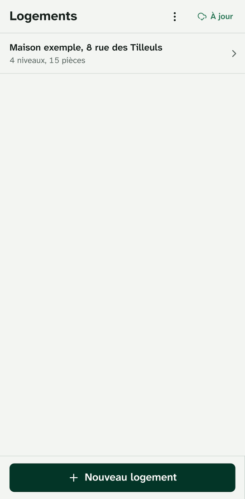
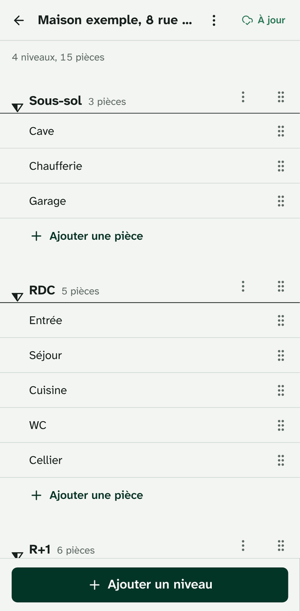
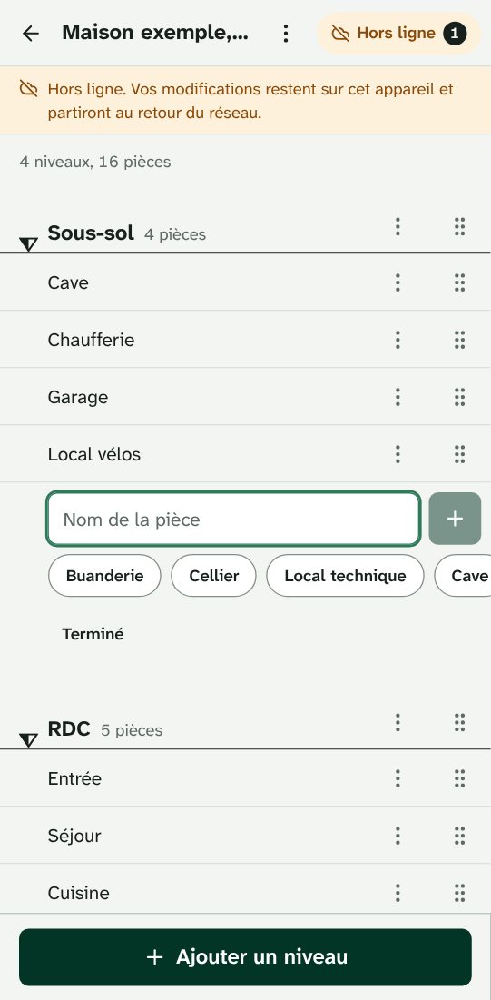
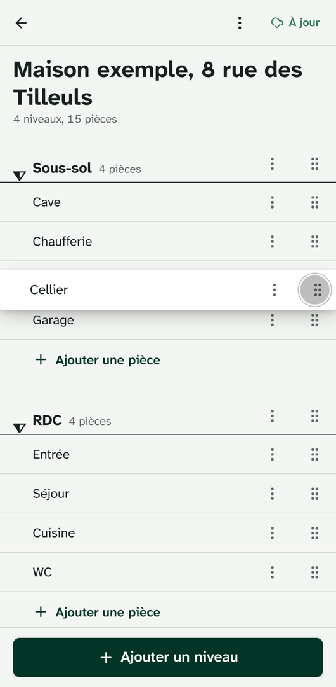

# Relevé: offline-first levels and rooms

Relevé is the levels-and-rooms part of a housing inspection app, built for Auditoo's take-home
exercise as if it were going to production. Property diagnosticians use it on site, phone in hand:
they create a *logement*, add its levels and rooms in a few taps, rename, delete and reorder them by
drag and drop, with or without network. Every change is saved on the device first and shows at
once; a Hono and PostgreSQL backend keeps every device in sync in the background, and nothing typed
is ever lost.

**Live demo: [releve-m2ma.onrender.com](https://releve-m2ma.onrender.com)**

Hosted on Render's free plan: the first request after a quiet period can take up to a minute to
wake the server. Once visited, the app opens from its cache and syncs when the server is up.

## Screenshots

<table>
  <tr>
    <td align="center">
      <br>
      <sub>Logements and sync status</sub>
    </td>
    <td align="center">
      <br>
      <sub>Levels and rooms</sub>
    </td>
  </tr>
  <tr>
    <td align="center">
      <br>
      <sub>Offline: changes wait on the device</sub>
    </td>
    <td align="center">
      <br>
      <sub>Drag a room to another level</sub>
    </td>
  </tr>
</table>

## Features

- **Logements, levels, rooms**: add them, rename in place (tap the name), delete with a swipe or
  from their ⋮ menu, and undo from the toast, or later from « Logements supprimés » and « Éléments
  supprimés » in the ⋮ menus.
- **Duplicate a level** with its rooms, for identical floors: R+1 becomes R+2, bedrooms take the
  next numbers (Chambre 4, Chambre 5), and the copy can be undone.
- **Drag and drop** by the grip handle: reorder rooms within a level, move a room to another level,
  reorder levels. The keyboard works too, and a room's menu moves it without dragging
  (« Déplacer vers… »).
- **Offline-first**: the app opens without network, every change appears instantly and is stored
  on the device, and everything syncs by itself when the connection returns.
- **Visible sync status**: a header pill (À jour, En attente, Envoi…, Hors ligne, Serveur
  injoignable, Erreur), an offline banner, the list of pending changes and a "Synchroniser
  maintenant" button.
- **Several devices**: changes reach the other devices within seconds (server-sent events), and
  conflicts resolve the same way everywhere (see [DESIGN.md](DESIGN.md#conflict-policy)).
- **Fast entry on site**: one-tap level and room suggestions in French, smart numbering
  (Chambre 1, Chambre 2…), levels listed from the lowest to the highest (a Sous-sol added after the
  RDC goes before it), and an example house to try it all.
- **Installable PWA**: « Installer l'application » in the home screen's menu (the browser's prompt,
  or Safari's steps on iPhone and iPad), a toast once the app works offline, an update prompt.
- **Mobile-first** (Chrome on Android, Safari on iOS): French UI, dark mode, 44 px touch targets,
  Atkinson Hyperlegible Next.

## Quick start

Requirements: Node.js 22.12 or later (see `.node-version`). No Docker, no PostgreSQL to install:
in development the API runs on [PGlite](https://pglite.dev), Postgres embedded in the process.

```sh
corepack enable   # provides the pnpm version pinned in package.json
pnpm install
pnpm dev
```

Open http://localhost:5173. Vite serves the web app and proxies `/api` to the API on
http://localhost:3000, which keeps its data in `apps/server/.data/pglite`. To use a real
PostgreSQL instead, set `DATABASE_URL`.

The service worker is only registered in production builds. To try the app offline locally:

```sh
pnpm build
pnpm start        # API and built PWA on http://localhost:3000
```

Then switch the network off in the browser's developer tools and keep working.

## Scripts

| Command | What it does |
| --- | --- |
| `pnpm dev` | API (watch mode, PGlite) and web app (Vite, proxying `/api`), side by side |
| `pnpm build` | Builds the web app (Vite, then a typecheck) and bundles the server (esbuild) |
| `pnpm start` | Production server: API and built PWA on port 3000 |
| `pnpm test` | All unit, integration and component tests (Vitest); no database needed |
| `pnpm test:watch` | The same, in watch mode |
| `pnpm e2e` | End-to-end tests (Playwright) against the production build: run `pnpm build` first. `E2E_PORT` picks the server's port (default 4174), e.g. to run two checkouts side by side |
| `pnpm typecheck` | `tsc` in every workspace, service worker included |
| `pnpm lint` / `pnpm format` | Biome: check, or fix formatting, lint issues and import order |
| `pnpm check` | `lint`, `typecheck` and `test` |
| `pnpm size` | Compressed sizes of the build against their budgets (CI fails past one): after `pnpm build` |
| `pnpm lighthouse [url]` | Lighthouse on an emulated phone against a running build (default `http://localhost:3000`): median of 3 runs, report in `.lighthouse/` |
| `pnpm --filter @repo/web icons` | Renders the PNG app icons from their SVG sources |

## Configuration

The server reads its environment at startup (`apps/server/src/env.ts`); blank values count as unset.

| Variable | Default | Meaning |
| --- | --- | --- |
| `DATABASE_URL` | unset | PostgreSQL connection string; when unset, the server uses PGlite |
| `PGLITE_DATA_DIR` | `.data/pglite` | PGlite directory, relative to the working directory, or `memory://` |
| `PORT`, `HOST` | `3000`, `0.0.0.0` | Listening address |
| `STATIC_DIR` | `apps/web/dist` | Built web app to serve, if it contains an `index.html` |
| `LOG_LEVEL` | `info` | `debug`, `info`, `warn` or `error` |
| `NODE_ENV` | `development` | `production` switches the logs to JSON lines |

## Project structure

```text
.
├── apps/
│   ├── server/                 Hono API, which also serves the built PWA
│   │   ├── scripts/build.mjs   esbuild bundle → dist/index.js
│   │   └── src/
│   │       ├── app.ts          routes: /api/health, /api/push, /api/pull, /api/events (SSE), SPA
│   │       ├── security-headers.ts  Content Security Policy, Permissions-Policy and the rest
│   │       ├── index.ts        startup: database, migrations, HTTP server, graceful shutdown
│   │       ├── db/             SQL client (node-postgres or PGlite) and migrations
│   │       └── sync/           push, pull, mutators on SQL (ServerTx), SSE pokes
│   └── web/                    React PWA
│       ├── e2e/                Playwright specs
│       ├── public/             manifest and icons
│       └── src/
│           ├── sync/           sync engine: client, IndexedDB storage, transport, React hooks
│           ├── features/       screens: logements, structure (levels and rooms), sync status
│           ├── components/     layout, swipe-to-delete, editable text, datum marker, ui/ (shadcn)
│           ├── lib/            French naming suggestions, haptics
│           ├── routes/         TanStack Router file routes: / and /logements/$propertyId
│           ├── sw.ts, pwa.ts   service worker (Serwist) and its registration
│           └── styles.css      Tailwind v4 theme: design tokens, dark mode
├── packages/
│   └── shared/src/             runs on both sides: schemas, mutators, positions, protocol, snapshot
├── scripts/                    bundle size budget, Lighthouse audit
├── docs/                       screenshots, AI workflow notes
├── .github/workflows/          CI, keep-warm ping
├── render.yaml                 Render Blueprint
├── DESIGN.md                   architecture and decisions
└── CLAUDE.md                   guide for AI coding agents
```

## Testing

```sh
pnpm test                 # 275 unit, integration and component tests, about a minute
pnpm build && pnpm e2e    # 16 end-to-end tests, accessibility and security included
```

- **Unit and integration tests** (Vitest) cover the shared domain, the server on an in-memory
  PGlite (security headers included), and the sync engine on fake-indexeddb against an in-memory
  reference server, including a seeded multi-device convergence simulation with flaky networks and
  restarts. A palette test checks the contrast of every colour pairing the UI paints, in both
  themes.
- **Component tests** (Vitest, [Testing Library](https://testing-library.com), happy-dom) drive the
  interaction-heavy components as a user would, by role and French accessible name: the swipe to
  delete (thresholds, flicks, axis lock, the swallowed click, failed deletions), renaming in place,
  rapid room entry, the sync indicator. They live next to the components (`*.test.tsx`).
- **End-to-end tests** (Playwright) drive an emulated Pixel 7 against the production server, which
  they start on port 4174 (or `E2E_PORT`) with a fresh in-memory database. Every test fails on an uncaught
  exception or a Content Security Policy violation. An accessibility spec scans every screen,
  sheet, menu, field and banner with [axe](https://github.com/dequelabs/axe-core) (WCAG 2.2 A and
  AA, best practices), in light and dark mode: a serious or critical violation fails it. Install
  the browser once with `pnpm --filter @repo/web exec playwright install chromium`. Tip: to use a
  Chromium already on your machine instead, set `PLAYWRIGHT_CHROMIUM_PATH=/path/to/chromium`.
- **CI** (`.github/workflows/ci.yml`, GitHub Actions) runs Biome, typecheck, unit tests, build, the
  bundle size budget and end-to-end tests on every push and pull request, and uploads the
  Playwright report on failure.

## Performance, accessibility, security

Lighthouse 13.5 (`pnpm lighthouse`), its default mobile run: Moto G Power emulation, simulated
slow 4G and 4× CPU slowdown, first visit (empty storage, no service worker yet), against the
production build (`pnpm start`) with an empty database. Median of 7 runs, 15 October 2026:

| Performance | Accessibility | Best practices | SEO |
| :---: | :---: | :---: | :---: |
| 91 | 100 | 100 | 100 |

First Contentful Paint 2.3 s, Largest Contentful Paint 2.6 s, Total Blocking Time 170 ms,
Cumulative Layout Shift 0. Measured with Chromium 141 on a 2-vCPU Linux container shared with
other builds, the browser at raised CPU priority to limit their effect: performance ranged from
84 to 95 across runs. Before the preloads, Brotli and the sliced first render, one run gave 80,
and SEO 91 (no robots.txt). Mounting bottom sheets on their first opening rather than closed
with the home screen moved nothing beyond that noise: the build before it, measured in turns with
it, also had a median of 91 (Total Blocking Time 200 ms). What remains is starting a
client-rendered app on a slow phone: evaluating React, the router and Zod, then React's first
commit. Next step: prerender the app shell into `index.html` so that something paints before the
JavaScript runs.

What a phone downloads (`pnpm size`; CI fails past a budget):

| | gzip | Brotli (sent when accepted) | Budget (gzip) |
| --- | ---: | ---: | ---: |
| Entry chunk (React, router, app shell) | 70.2 kB | 60.9 kB | 80 kB |
| Everything before the first screen (entry and preloads) | 199.3 kB | 174.7 kB | 220 kB |
| All JavaScript, lazy screens included | 222.2 kB | 195.2 kB | 260 kB |
| CSS | 7.8 kB | 6.9 kB | 10 kB |

The server sends a Content Security Policy that keeps everything on the app's origin and scripts
to its own files (no inline code, no `eval`), a Permissions-Policy that denies the powerful
features the app does not use (camera, geolocation, payment…), `Referrer-Policy: no-referrer`,
HSTS, `X-Frame-Options: DENY` and same-origin COOP and CORP (`apps/server/src/security-headers.ts`).

## Deployment

`render.yaml` is a [Render Blueprint](https://render.com/docs/blueprint-spec): one web service for
the API and the PWA, and one PostgreSQL database, both on the free plan in Frankfurt.

1. Push the repository to GitHub.
2. In the Render dashboard, choose **New → Blueprint**, select the repository and apply. Render
   creates the `releve` web service and the `releve-db` database, and wires `DATABASE_URL`.
3. The service builds with `pnpm build`, migrates the database at startup, and goes live once
   `/api/health` answers.
4. Optional: free instances sleep after 15 idle minutes. To keep the demo awake, set the GitHub
   repository variable `APP_URL` (Settings → Secrets and variables → Actions → Variables) to the
   service URL: `.github/workflows/keep-warm.yml` then pings it every 10 minutes.

After restoring a database backup, run `UPDATE server_meta SET epoch = gen_random_uuid();` so that
devices resync from the restored data (see
[DESIGN.md](DESIGN.md#replaced-databases-reset-and-epoch)).

## Documentation

- [DESIGN.md](DESIGN.md): architecture, data model, sync strategy, decisions and tradeoffs.
- [CLAUDE.md](CLAUDE.md): conventions and checklists for AI coding agents, useful to humans too.
- [docs/ai/](docs/ai/): how AI tools were used to build this project.
